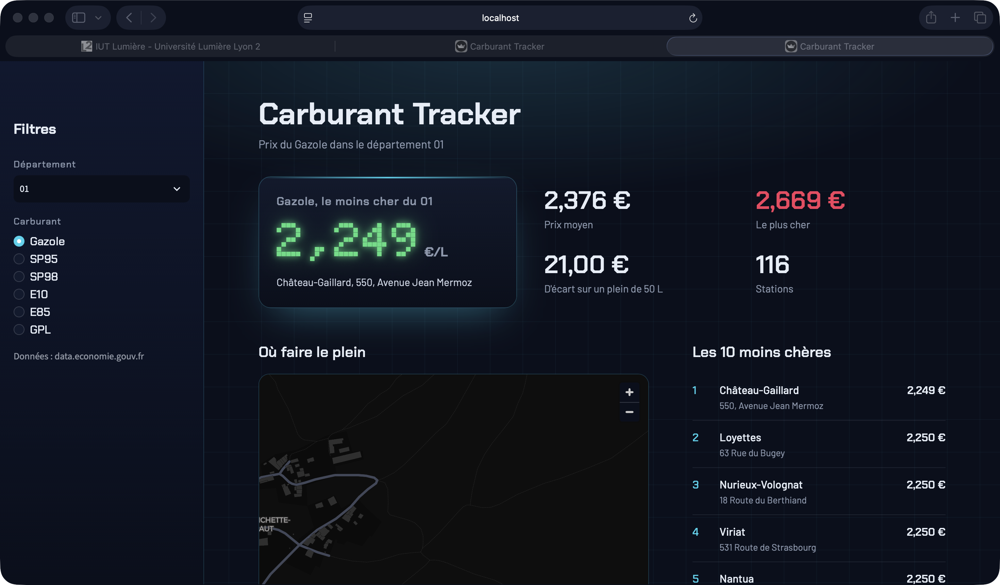

# Carburant Tracker

Un projet perso pour savoir où faire le plein le moins cher, construit à partir des données publiques sur les prix des carburants.



Technos : Python, PostgreSQL, Docker Compose, Streamlit, pandas.

## Pourquoi ce projet

Je suis en 2e année de BUT Science des Données à Lyon et je m'oriente vers le data engineering. Je voulais un projet qui couvre toute la chaîne : aller chercher la donnée à la source, la stocker proprement et la rendre utile. Les prix des carburants s'y prêtaient bien : c'est une vraie API publique, les prix bougent tous les jours, et tout le monde comprend à quoi ça sert.

Je l'ai commencé en juin, mis de côté pendant l'été, puis repris pour le terminer.

## Ce que ça fait

Un script Python récupère les prix de toutes les stations de France via l'API officielle (data.economie.gouv.fr), soit environ 9 800 stations et 30 000 prix. Il les range dans une base PostgreSQL, avec une ligne par station et par carburant. Une contrainte empêche d'enregistrer deux fois le même prix : on peut relancer le script autant de fois qu'on veut sans créer de doublons, et l'historique ne garde que les vrais changements de prix.

Un dashboard Streamlit affiche ensuite, pour un département et un carburant, la station la moins chère, le prix moyen, l'écart de prix sur un plein de 50 L, une carte des stations et le top 10.

## Ce que j'ai appris

Ce qui m'a le plus fait progresser, c'est le terminal. En juin, je le découvrais à peine, et je me contentais de lancer les commandes qu'on me proposait. Mais j'avais demandé à Claude de m'expliquer systématiquement chaque commande et chaque option, et petit à petit, j'ai commencé à en comprendre la logique : comment une commande est construite, ce que font ses options, comment on en enchaîne deux, comment on lit une erreur. Aujourd'hui, je me sens à l'aise pour naviguer dans mes dossiers, créer et modifier des fichiers, piloter mes conteneurs Docker ou comprendre un message d'erreur.

C'était aussi ma première fois avec Docker. J'ai compris pourquoi on isole chaque brique dans un conteneur, comment les faire démarrer dans le bon ordre, et pourquoi `localhost` à l'intérieur d'un conteneur ne désigne pas mon ordinateur. J'ai aussi eu un conflit de port avec la base d'un autre de mes projets, ce qui m'a forcé à comprendre ce qu'est vraiment un port.

Côté PostgreSQL, j'ai appris à concevoir une table à partir de ce que renvoie une API, et à utiliser `ON CONFLICT` pour qu'un chargement puisse être relancé sans risque. Et j'ai découvert Streamlit : c'est impressionnant de passer d'un script Python à une page web aussi vite, et un peu frustrant dès qu'on veut personnaliser le design.

## Comment j'ai travaillé

J'ai mené ce projet avec Claude (Anthropic) comme assistant de développement. La partie Streamlit, c'est lui qui l'a gérée. Pour la récupération des données, j'ai écrit les premiers appels à l'API moi-même et il me corrigeait quand ça ne marchait pas, puis il m'a fourni la version finale du chargement en base. Pour Docker, il m'a donné les fichiers de configuration, et je me suis fait expliquer chaque ligne avant de les lancer. Aujourd'hui, je suis capable d'expliquer chaque partie du code.

Le projet ne manipule que des données publiques en open data, sans aucune donnée personnelle. Vérifier ce que je transmets à une IA avant de le faire est un réflexe que je tiens de mon stage en collectivité, où j'ai cartographié les usages de l'IA et travaillé sur la gouvernance des données.

## Le lancer

Il faut juste Docker Desktop. Depuis le dossier du projet :

```bash
docker compose up --build
```

Puis ouvrir http://localhost:8501. Au premier lancement, la base est créée automatiquement, les prix du jour sont chargés, et le dashboard démarre une fois le chargement terminé. Les identifiants de la base présents dans le code sont des identifiants de démo, utilisés uniquement en local.

## La suite

Pour l'instant, le pipeline se lance à la main. La prochaine étape, c'est de le planifier chaque jour avec Airflow pour accumuler un vrai historique, puis d'ajouter une API avec FastAPI. À terme, j'aimerais montrer l'évolution des prix dans le temps : c'est là que le projet deviendra vraiment intéressant.
